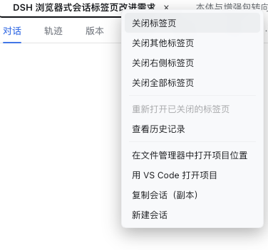
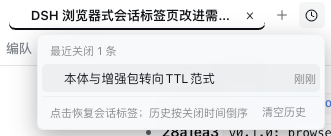
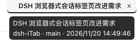
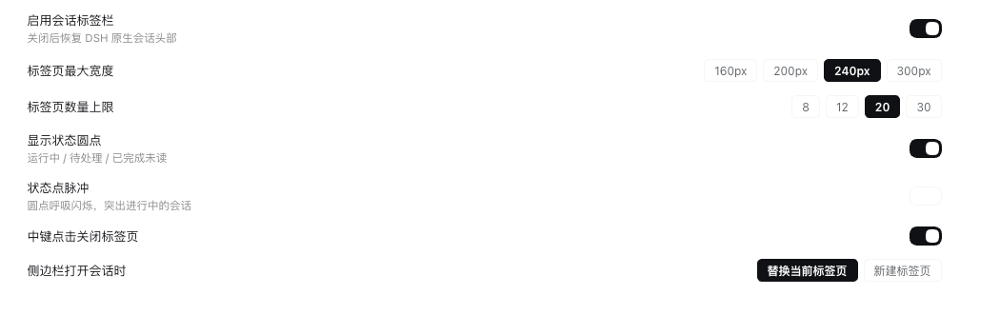

# dsh-iTab — DSH 浏览器式会话标签页

[](https://dsh-plugin.org/plugins/super-new13/dsh-itab)

> Browser-style session tabs for [DeepSeek Harness](https://github.com/deepseek-ai/deepseek-harness) (DSH)：更宽敞的标签条、完整的右键菜单、关闭历史、悬停气泡（含 Git 分支）、一键用 VS Code / 系统文件管理器打开项目。

为 DSH（DeepSeek Harness）带来浏览器级的会话标签页体验。


## 功能总览

### 1. 宽松的标签条

标签自适应伸展、共享整行空间：最长 **240px**（可调 160–300px），最小 96px，`flex` 布局自动分配 —— 不再是挤在一起的小胶囊。标签数量上限默认 **20**（可调 8/12/20/30，超出自动淘汰最旧的）。

- 状态圆点：🟠 运行中（含**子代理运行中**的父会话）/ 🟡 等待处理 / 🟢 已完成未读（可选呼吸脉冲光晕）
- 拖拽重排、滚轮横向滚动、键盘导航（← → 切换、Enter 确认、Esc 关菜单）
- 标签太多放不下时自动出现「⋯」下拉，列出全部标签
- 标签列表持久化（`localStorage`），重启 DSH 后原样恢复
- **会话在左侧被删除时，它的标签页自动关闭**

### 2. 浏览器式右键菜单



| 菜单项 | 说明 |
|---|---|
| 关闭标签页 | 等价于标签上的 ×，或**中键点击** |
| 关闭其他标签页 | 只保留当前标签并切换过去 |
| 关闭右侧标签页 | 关闭本标签右边的所有标签 |
| 关闭全部标签页 | 标签栏进入空状态（只剩 +），**不会**自作主张新建会话 |
| 重新打开已关闭的标签页 | 恢复最近关闭的一个（栈深 20） |
| 查看历史记录 | 打开历史面板（见下） |
| 在文件管理器中打开项目位置 | Finder / 资源管理器直达会话的项目目录 |
| 用 VS Code 打开项目 | 跨平台自动定位 `code` CLI（见下） |
| 复制会话（副本） | fork 会话并立即打开 |
| 新建会话 | 等价于标签栏的 + |

关闭语义与浏览器一致：关闭当前标签自动切到右侧邻居；关闭最后一个标签后标签栏保持空状态，屏幕上的会话不受影响，也不会“复活”刚关掉的标签。

删除语义则跟随会话本身：在左侧列表里删除一个会话，它的标签页会**自动关闭**。删除不等于“关闭”——它不会进入关闭历史（删除的会话无法恢复，所以历史面板里也没有可点的条目），也不会让“重新打开已关闭的标签页”把它带回来。宿主会话列表尚未加载完成、或列表某一帧是空的（重连、列表重载会短暂如此）时一律不做清理，避免把持久化的标签整条误删。

如果删掉的正是你正在看的那个会话，标签栏不会为宿主新建的空白会话再开一个标签，而是**切到最后一个还在的标签**（就像关掉浏览器里当前的标签会落到邻居上）；只有当确实没有别的标签可去时，才保留那个空白会话的标签。

### 3. 关闭历史



标签栏的时钟按钮（或右键菜单）打开历史面板：

- 按关闭时间**倒序**列出最近关闭的 50 个会话，相对时间显示（刚刚 / N 分钟前 / N 小时前 / N 天前）
- 点击任意条目直接恢复该标签（条目保留在历史里，可反复恢复）
- 已删除的会话灰显不可点（直接在左侧删除的会话不会进历史，因为删除不可逆）
- 支持一键清空；历史持久化在 `localStorage`（`dsh.itab.history.v1`）

### 4. 悬停气泡 + Git 分支



悬停标签 300ms 弹出两行气泡：**完整标题** + `项目名 · Git 分支 · 最后活跃时间`。

Git 分支由宿主侧路由 `POST /dsh-itab/git-branch` 实时读取（`git symbolic-ref`，20s 服务端缓存 + 30s 客户端缓存，微任务合批；非 git 目录静默省略，不报错）。

气泡跟随指针、越界自动翻转，Esc / 滚轮 / 点击关闭。

### 5. 用 VS Code 打开项目（跨平台）

宿主侧路由 `POST /dsh-itab/open-in-vscode` 按平台枚举常见安装位置自动定位 `code` CLI（GUI 启动的宿主没有 shell PATH，所以绝对路径优先）：

| 平台 | 候选顺序 |
|---|---|
| macOS | `/opt/homebrew/bin/code` → `/usr/local/bin/code` → `/Applications/Visual Studio Code.app/…/bin/code` → PATH |
| Windows | `%LOCALAPPDATA%\Programs\…\code.cmd`（用户安装）→ `%ProgramFiles%\…\code.cmd`（系统安装）→ PATH |
| Linux | `/usr/bin/code` → `code-oss` → `/snap/bin/code` → `/usr/local/bin/code` |

### 6. 配置页



设置 → 插件 → dsh-itab，所有配置即时生效并持久化（`dsh.itab.view.v2`；v1 会自动迁移，`sidebarOpen` 之外的首选项全部保留）：

| 配置项 | 默认 | 说明 |
|---|---|---|
| 启用会话标签栏 | 开 | 关闭后恢复 DSH 原生会话头 |
| 最大标签宽度 | 240px | 160 / 200 / 240 / 300 |
| 标签数量上限 | 20 | 8 / 12 / 20 / 30 |
| 显示状态圆点 | 开 | 运行中 / 待处理 / 已完成未读 |
| 状态点脉冲 | 开 | 呼吸光晕突出进行中的会话（尊重系统“减弱动态效果”） |
| 中键点击关闭 | 开 | 浏览器习惯 |
| 侧边栏打开方式 | 新建 | **新建**标签（浏览器语义，保留当前标签）/ **替换**当前标签 |

## 安装

将下方的 `web` 换成你实际使用的 DSH Web Profile 名称，然后重启该 Profile 对应的 Web 服务。

```sh
dsh plugin --profile web add 'github:super-new13/dsh-iTab#ff55900318283fab27635e12f98c2eb6a88c34e8'
```

已在 macOS 上用 DSH `0.2.2-rc.3`、Node `24.21.0` 和 pnpm `10.16.1` 通过独立 Profile 验证安装，`--dump-config` 可看到 `dsh-itab` 配置层。此次验证覆盖 CLI 安装和配置加载，未覆盖 Windows 实机和 Web 界面操作。

### 依赖

- DSH `>=0.2.0-rc.1 <0.3.0-0`（在 0.2.2-rc.3 上开发验证）
- 无任何 npm 运行时依赖；Node 22+（构建与测试）

### 本地数据与宿主操作

标签、关闭历史与偏好保存在浏览器 `localStorage`。Git 分支由 DSH 宿主读取。菜单中的 VS Code 和文件管理器快捷操作在宿主打开项目路径。Windows 上的 VS Code 快捷操作使用命令解释器处理项目路径，建议暂不使用该快捷操作。

## 开发

```
npm run build   # 拼装 src/client/*.js → src/client.bundle.js（零依赖，纯文本拼接）
npm test        # node --test（标签模型 / 气泡定位 / 分支缓存 / VS Code 打开 / bundle 冒烟）
```

项目结构：

```
src/
  index.js            宿主半：git-branch 与 open-in-vscode 两条路由
  client.bundle.js    构建产物（唯一客户端入口，勿手改）
  client/
    model.js          纯标签状态机（开/关/批量关/历史/重排/调和，可独立测试）
    strip.js          标签条、右键菜单、溢出菜单、历史面板
    hooks.js          溢出测量、居中贴靠、拖拽重排、chips 停靠等 React hooks
    tooltip.js        悬停气泡（跟随指针、越界翻转）
    gitbranch.js      分支缓存客户端 + 外部打开桥接
    config.js         配置页
    entry.js          插件入口（插槽注册、locale、服务注入）
cordis.patch.yml      宿主侧激活行
dsh.plugin.json       插件清单
```

设计约定：客户端各模块不使用 `import`，共享一个 bundle 闭包作用域（`P`、`ITAB_CSS` 等）；`model.js` / `tooltip.js` / `gitbranch.js` 保留真实 ESM 导出供 node 测试直接加载，构建时统一剥掉 `export` 前缀。

## 许可

MIT，详见 [LICENSE](./LICENSE)。
